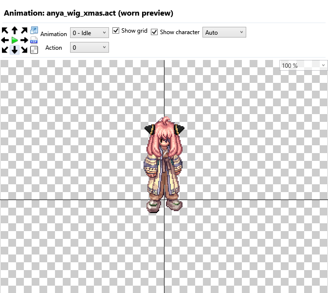

# Ragnarok GRF Editor

GRF Editor pour Ragnarok Online, avec un personnage de référence dans **Animation preview** pour voir directement le rendu des hats portés.

Version dérivée de [Tokeiburu/GRFEditor](https://github.com/Tokeiburu/GRFEditor). Les fonctions d’édition des archives GRF/GPF/Thor et l’historique du projet d’origine sont conservés.

## Télécharger

Télécharger **[Ragnarok-GRF-Editor-v1.0.0.zip](https://github.com/AngeHell47/Ragnarok-GRF-Editor/releases/latest)** dans la dernière release, décompresser l’archive et lancer **GRF Editor.exe**. Conserver **GRF Editor.exe.config** à côté de l’exécutable.

L’exécutable compilé est également disponible séparément dans les fichiers de la release. Les bibliothèques nécessaires et les personnages de référence sont intégrés à l’EXE.

Prérequis : **Windows et .NET Framework 4.8**.

## Preview des hats

1. Ouvrir un GRF et sélectionner un sprite dans la liste.
2. Afficher l’onglet **Animation preview**.
3. **Show character** affiche ou masque le personnage ; le choix est mémorisé.
4. **Auto / Male / Female** sélectionne le personnage. Le mode Auto suit le dossier masculin ou féminin du sprite.
5. Utiliser les directions et les animations habituelles pour examiner le hat.



Si le fichier sélectionné est un sprite d’objet au sol, la preview recherche automatiquement sa version portée dans le GRF ouvert. Cela évite d’afficher une icône centrée sur le corps : par exemple, `anya_wig_xmas.act` possède une image d’objet au sol et des animations portées distinctes.

L’en-tête indique **(worn preview)** lorsque cette version portée est utilisée. Masquer le personnage rétablit l’animation du fichier sélectionné. La preview ne modifie pas les ACT, les SPR ou le GRF. La version portée doit être présente dans le GRF ouvert pour que la correspondance automatique fonctionne.

## Compiler

Prérequis : Visual Studio ou Build Tools avec MSBuild, les outils WPF/.NET Framework 4.8 et le SDK .NET nécessaire aux bibliothèques .NET Standard du projet.

```powershell
.\Build-CharacterPreview.ps1
```

Le résultat se trouve dans **GRFEditor/bin/CharacterPreview**. Distribuer **GRF Editor.exe** et **GRF Editor.exe.config**. Le script incorpore les dépendances compressées dans l’exécutable.

Le script compile directement le projet de l’application : la solution publique référence un projet Encryption non distribué, dont la DLL est fournie dans `Libraries`.

## Validation

- Compilation Release et démarrage de l’exécutable autonome.
- 20 hats réels, deux personnages, 55 432 frames de référence vérifiées.
- Rendu WPF de toutes les actions et frames d’Anya, changement de sexe, affichage/masquage et mémorisation du réglage.
- Vérification que les ACT et l’entrée GRF d’origine restent identiques.

Les tests d’intégration sont dans [Tests/CharacterPreview](Tests/CharacterPreview/README.md). Ils utilisent un GRF local fourni par la personne qui les lance ; les costumes ne sont pas inclus dans le dépôt.

## Crédits

- **Tokeiburu** et les contributeurs de [GRFEditor](https://github.com/Tokeiburu/GRFEditor) pour l’application d’origine et ses bibliothèques.
- [Tokeiburu/ActEditor](https://github.com/Tokeiburu/ActEditor) pour les ressources de corps et de tête de référence.
- Cette version ajoute la preview sur personnage, le masquage, le choix du sexe et la recherche automatique du sprite porté.

Voir [les détails techniques](CHARACTER-PREVIEW.md) et [la documentation d’origine de la bibliothèque GRF](docs/UPSTREAM-GRF-LIBRARY.md).
